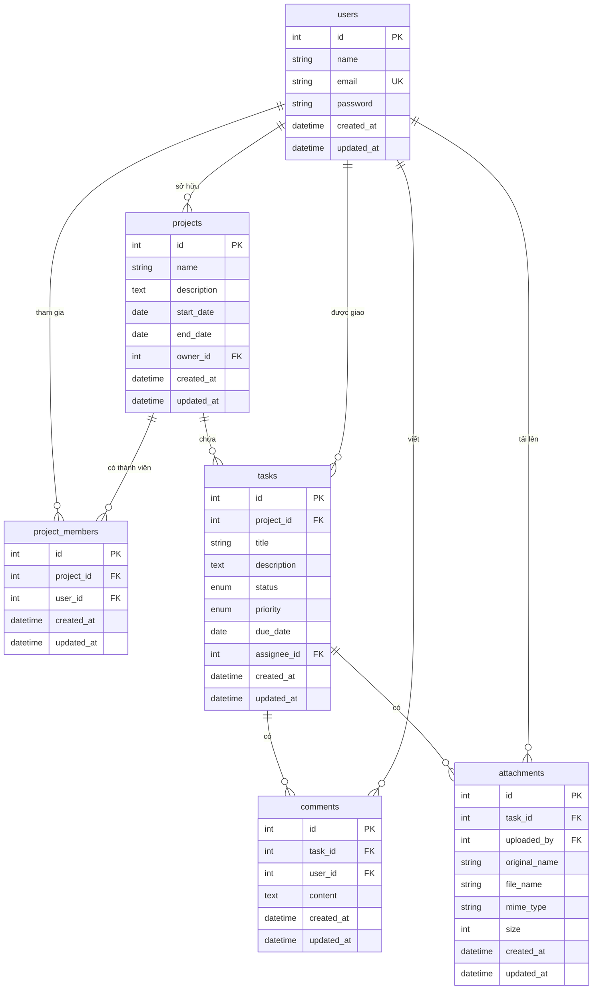

# ERD - Task Management Web App

## Ràng buộc quan trọng

- `users.email` là duy nhất; `users.password` lưu chuỗi đã hash bằng bcrypt.
- `projects.owner_id` tham chiếu `users.id`.
- `project_members` có ràng buộc duy nhất trên cặp `(project_id, user_id)`.
- `tasks.project_id` tham chiếu `projects.id`; xóa dự án sẽ xóa toàn bộ công việc của dự án (`ON DELETE CASCADE`).
- `tasks.assignee_id` tham chiếu `users.id`; khi người dùng bị xóa, công việc chuyển về chưa có người phụ trách (`ON DELETE SET NULL`).
- `comments.task_id`, `attachments.task_id` xóa theo công việc (`ON DELETE CASCADE`).
- `comments.user_id`, `attachments.uploaded_by` xóa theo người dùng (`ON DELETE CASCADE`).

## Quan hệ tóm tắt

| Quan hệ | Kiểu | Mô tả |
| --- | --- | --- |
| users - projects | 1 - N | Một người sở hữu nhiều dự án |
| users - projects | N - N | Một người tham gia nhiều dự án, một dự án có nhiều thành viên (qua `project_members`) |
| projects - tasks | 1 - N | Một dự án có nhiều công việc |
| users - tasks | 1 - N | Một người được giao nhiều công việc |
| tasks - comments | 1 - N | Một công việc có nhiều bình luận |
| tasks - attachments | 1 - N | Một công việc có nhiều tệp đính kèm |
